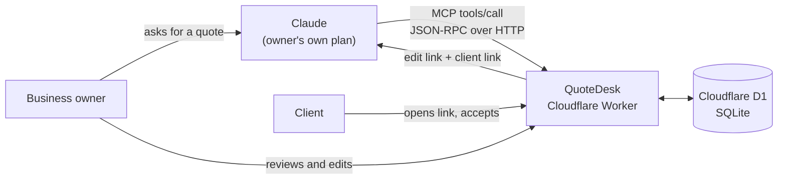

# QuoteDesk

**A remote MCP server and web app.** Claude drafts sales quotes through MCP tools; QuoteDesk stores them, lets the owner edit them, and hosts a link the client can open and accept.

A small service business pastes a client's request into Claude. Claude writes the line items, scope and pricing and sends the quote into QuoteDesk through MCP. The owner edits it in QuoteDesk and shares one link. The client opens the link and clicks Accept, and QuoteDesk records who accepted and when. Later, Claude can ask QuoteDesk which quotes were opened but never answered and help draft the follow-ups.

There is no AI inside this app: no OpenAI, Anthropic or other AI keys, SDKs or calls. Claude does the thinking on the customer's own plan; QuoteDesk stores, edits, hosts and tracks.

Built end to end in 24 hours, from idea to a live product, as a take-home for Volopay's Founder's Office, Product & Growth role.

## What this project shows

- **Tool design for AI agents.** Five MCP tools with descriptions, JSON input schemas and server instructions written so Claude picks the right tool, fills arguments correctly and tells the user what to do next.
- **A remote MCP server built from the protocol up.** Hand-written JSON-RPC 2.0 over Streamable HTTP with protocol version negotiation. Works with Claude's custom connectors and the official MCP SDK client.
- **Guardrails around agent actions.** The server is the source of truth: totals are computed on the server, accepted quotes are locked against edits from Claude, the owner can't accept on the client's behalf, and failures come back as tool errors Claude can recover from.
- **Shipping a full product, not a demo script.** Data model, auth, owner dashboard, client-facing page, activity log and per-workspace connector keys, deployed on Cloudflare's edge and tested end to end against the live URL.
- **Product and business thinking.** A clear customer, a reason to exist next to Claude, pricing and unit economics (about ₹13 to serve a ₹499 customer, because the customer's own Claude does the AI work).

## Architecture



## Try it

- Live app: https://quotedesk.harsha-quotedesk.workers.dev
- Test login: `demo@quotedesk.app` / `volopay-demo`
- MCP URL: `https://quotedesk.harsha-quotedesk.workers.dev/mcp/demo-volopay`

To connect it to Claude: open Settings, then Connectors, and click Add custom connector. Name it QuoteDesk, paste the MCP URL, choose No sign-in and add it. In a new chat, turn QuoteDesk on from the + menu under Connectors and try:

> Create a quote for Riya at Bloom Cafe: logo, menu design and Instagram setup, about ₹60k.

Claude returns an edit link (open it while logged in) and a client link (open it in a private window to accept as the client).

## How it works

One Cloudflare Worker with one SQLite database (Cloudflare D1) serves three things: the MCP endpoint, the owner's dashboard and the client's quote page.

1. The owner asks Claude for a quote. Claude writes the items, scope, tax and terms.
2. Claude calls `create_quote` on the owner's private MCP URL (`/mcp/<workspace key>`). The Worker saves the quote and returns an edit link and a client link.
3. The owner edits it in the dashboard. Every change is written to an activity log.
4. The client opens their link, which marks the quote as sent and viewed, then accepts or declines.
5. Claude reads results back with `list_quotes` and `get_quote`.

| Tool | What it does |
|---|---|
| `create_quote` | Creates a draft quote with line items, tax, discount, notes, terms and validity |
| `update_quote` | Changes any field or replaces the items. Locked once the client responds |
| `list_quotes` | Lists quotes with status, total and whether the client opened them |
| `get_quote` | Full quote with items, client response and activity history |
| `get_business_profile` | Business name, default currency, tax rate and terms |

### Implementation notes

- The MCP server is hand-written: stateless JSON-RPC over Streamable HTTP, JSON responses, no SDK on the server side (`src/mcp.js`).
- Pages are server-rendered HTML with no framework or build step (`src/views.js`).
- Money is stored as integer paise and every total is computed on the server, so Claude and the editor always agree.
- State rules: the owner can preview a quote but can't accept it for the client, only the first client response counts, expired quotes can't be accepted, and accepted or declined quotes are locked against edits from the app and from Claude.
- Passwords are hashed with PBKDF2 (Web Crypto), sessions use HttpOnly cookies, and client links use random IDs.

| File | Contents |
|---|---|
| `src/index.js` | Routing, auth, dashboard, editor and client page handlers |
| `src/mcp.js` | MCP endpoint and the five tools |
| `src/db.js` | D1 queries, totals, status rules |
| `src/auth.js` | Password hashing and sessions |
| `src/views.js` | HTML templates |
| `schema.sql` | Database schema |
| `scripts/setup.mjs` | One-command deploy |
| `scripts/test-mcp.mjs` | End-to-end test with the official MCP SDK client |

## What is real and what is simulated

Real and working: the MCP server and all five tools, creating and editing quotes from Claude, editing in the web app, the public client page with accept and decline, view and acceptance tracking, and workspace signup with a private connector URL per workspace.

Simulated or not built yet:

- The demo business "Pixel & Pine Studio" and its address and GSTIN are sample data.
- The Free, Pro and Team plans on the homepage are a pricing proposal. There is no billing and no plan limits are enforced.
- Logo upload, email or WhatsApp alerts and team seats are planned, not built.
- The app doesn't email quotes; the owner shares the client link.
- The connector uses a private URL as its key instead of OAuth.

## Run it yourself

Needs Node 18+ and a free Cloudflare account.

```bash
npm install
npm run setup      # logs in to Cloudflare, creates the D1 database, creates tables, deploys
```

Then test the live MCP endpoint:

```bash
npm run test:mcp -- https://<your-worker>.workers.dev/mcp/demo-volopay
```

Local development: `npm run db:local` once, then `npm run dev` and open http://localhost:8787.

The demo workspace is created automatically on the first request from the values under `[vars]` in `wrangler.toml`. Set `SHOW_DEMO_LOGIN = "true"` there to show the demo credentials on the login page.

## Next steps

OAuth sign-in for the connector, alerts when a client opens or accepts, a custom domain and logo upload, then a payment link on accepted quotes so the client can pay the advance in the same place.

## Author

Built by Harsha Talapaka, data scientist working on AI search, recommendation and LLM pipelines.

[LinkedIn](https://linkedin.com/in/harsha-talapaka/) · [Portfolio](https://harshaa1231.github.io/HarshaPortfolio.github.io/) · [GitHub](https://github.com/harshaa1231)
